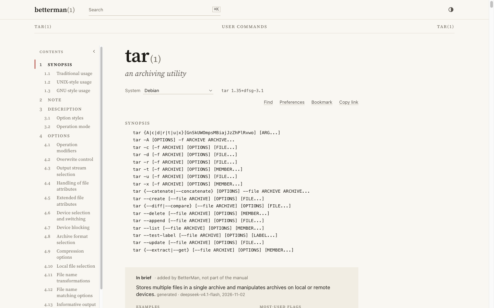
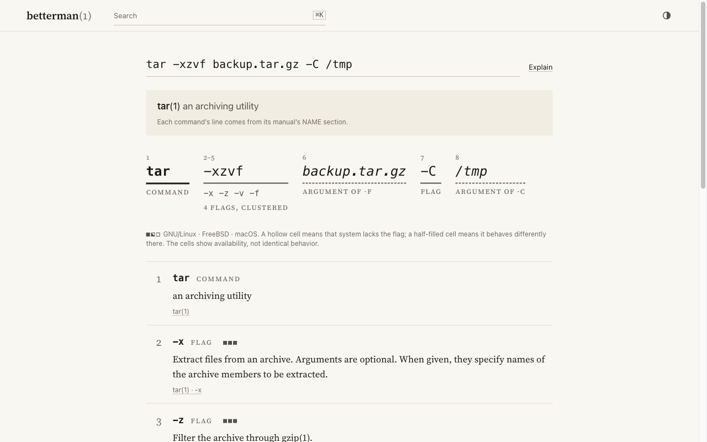

<div align="center">

<a href="https://betterman.sh"></a>

# BetterMan

Unix manual pages, typeset for the screen.

[betterman.sh](https://betterman.sh)

<a href="https://github.com/amanthanvi/BetterMan/actions/workflows/ci.yml"></a>
<a href="LICENSE"></a>

<br>

<a href="https://betterman.sh/tar">
  <picture>
    <source media="(prefers-color-scheme: dark)" srcset="docs/assets/readme/man-page-dark.png">
    
  </picture>
</a>

</div>

<br>

BetterMan is a web reader for man pages. Each page starts with a one-line summary, a few examples and the flags people reach for most, then gives you the upstream manual unchanged, with a filterable index of its options. You don't need an account. Bookmarks, history and reading preferences are kept in your browser.

## What it does

- Search understands task phrases as well as names. `extract a tarball` finds `tar(1)`, `open(2)` goes straight to the system call, and small typos still match.
- The URLs are short enough to type. `betterman.sh/tar` opens the section `man` itself would pick, `betterman.sh/tar/-x` lands on the flag, and `curl -L betterman.sh/tar.txt` prints the page as plain text. You can also add BetterMan to your browser as a search engine.
- It covers the full Debian trixie main archive, full archive imports of Ubuntu 24.04, Fedora 44, Arch and Alpine 3.23, the FreeBSD 15.1 base system, and the macOS pages whose license allows it. That comes to a little over 400,000 pages.
- When a flag behaves differently on another system, it gets a portability marker. The markers come from diffing the real manuals. If several packages ship a page with the same name (`nc`, `awk` and `vi` are the usual suspects), a switch lets you pick the package.
- On a man page the pager keys work: <kbd>j</kbd> and <kbd>k</kbd> scroll, <kbd>/</kbd> finds, <kbd>n</kbd> and <kbd>N</kbd> step through matches, and <kbd>[</kbd> and <kbd>]</kbd> move between sections. <kbd>⌘</kbd> <kbd>K</kbd> opens the command palette anywhere, and <kbd>?</kbd> lists every shortcut.
- About 9,500 pages are translated into German, French, Spanish, Brazilian Portuguese, Japanese or Russian, taken from Debian's manpages-l10n packages. Pages without a translation fall back to English. The interface is translated into the same six languages.
- Man pages are plain server-rendered HTML. The only JavaScript is an inline script that applies your theme before the first paint and a small static bundle. Pages you've read recently work offline, the site installs as an app, and there's a print stylesheet and a dark theme.

## Explain

Paste a shell line into Explain and it labels each command, flag and argument and links it to its definition in the manual. Clustered flags such as `-xzvf` are split into `-x -z -v -f`. Three small squares next to each flag show whether GNU/Linux, FreeBSD and macOS have it, with a half-filled square where it behaves differently.

Explain is a parser for a defined subset of shell grammar, and no language model is involved. When it can't parse a line safely it tells you so, which means it will turn down some valid input.

<div align="center">
<a href="https://betterman.sh/explain?cmd=tar%20-xzvf%20backup.tar.gz%20-C%20%2Ftmp">
  <picture>
    <source media="(prefers-color-scheme: dark)" srcset="docs/assets/readme/explain-dark.png">
    
  </picture>
</a>
<br>
<sub><a href="https://betterman.sh/explain?cmd=tar%20-xzvf%20backup.tar.gz%20-C%20%2Ftmp">Open this example on betterman.sh</a></sub>
</div>

## Generated text

The manual itself comes from upstream and is parsed without edits. The one-line summaries, the task phrases search uses, and extra examples for pages with fewer than three are generated when the dataset is built, so no model runs when you load a page. Each generated line names the model and the date. Every flag in a generated example is checked against that page's options table, and the example is dropped if any flag is missing. Commands that destroy data, such as `rm`, `dd` and `mkfs`, get no generated text.

Examples from [tldr-pages](https://github.com/tldr-pages/tldr) are credited and link to the upstream file. If you find a mistake, the Report a problem link on every page opens a prefilled GitHub issue.

## Development

The app is [Next.js](https://nextjs.org) on top of [Convex](https://convex.dev). A Python pipeline renders each page with `mandoc` and converts the output into a typed document model.

```text
nextjs/      The web app: pages, API routes, rendering
convex/      Schema and functions: dataset reads, search, rate limits, ingest
ingestion/   Python pipeline: mandoc to document model, uploads releases to Convex
scripts/     CI and deploy helpers
docs/        Architecture, releasing, runbooks
```

### Running it locally

You need Node 26, pnpm 10.34, Python 3.14 and [uv](https://docs.astral.sh/uv/).

```bash
pnpm install
pnpm convex:check                       # provisions a local Convex deployment, writes .env.local
npx convex env set RATE_LIMIT_TAG_KEY dev
RATE_LIMIT_TAG_KEY=dev pnpm next:dev    # Convex watcher + Next.js at http://localhost:3000
```

> [!NOTE]
> Next.js and Convex must share the same `RATE_LIMIT_TAG_KEY`. If they don't, search and page API routes return 429.

The local database starts empty. With `pnpm next:dev` running, load the test fixture from a second terminal:

```bash
npx convex env set CONVEX_INGEST_SECRET dev
set -a; . ./.env.local; set +a
BETTERMAN_E2E_SEED=1 CONVEX_INGEST_SECRET=dev \
  CONVEX_HTTP_URL="${CONVEX_SITE_URL:-$VITE_CONVEX_SITE_URL}" \
  node scripts/seed-convex-e2e.mjs
```

<details>
<summary>Commands</summary>
<br>

| Area | Command | What it does |
| --- | --- | --- |
| Web app | `pnpm next:lint` | ESLint |
| | `pnpm next:grammar` | Checks the visual rules in [`DESIGN.md`](DESIGN.md) |
| | `pnpm next:test` | Unit tests (Vitest) |
| | `pnpm next:e2e` | End-to-end tests (Playwright, app must be on port 3000) |
| | `pnpm next:build` | Production build |
| Convex | `pnpm convex:check` | Validates schema and functions |
| | `pnpm convex:test` / `convex:typecheck` | Integration tests and type checks |
| | `pnpm convex:related-check` | Confirms active releases are verified, sealed and complete (needs a deploy key) |
| Ingestion | `pnpm ingest:test` / `ingest:lint` | Tests and Ruff |
| | `pnpm ingest:sample` | Ingests five pages into the configured Convex stage |
| Ops | `pnpm perf:check` | Enforces the [performance budgets](docs/performance-budgets.md) |
| | `pnpm deps:provenance` / `ops:test` | Verifies Vercel provenance and tests operational gates |

</details>

### Deploys and data

Pushes to `main` that pass CI deploy to Vercel through [`deploy.yml`](.github/workflows/deploy.yml). The dataset is rebuilt monthly by [`update-docs.yml`](.github/workflows/update-docs.yml): each release is ingested, verified, sealed and staged before it's promoted, and rolling back means pointing production at the previous release. Production builds load cookieless [Vercel Web Analytics](docs/analytics.md).

[`docs/ARCHITECTURE.md`](docs/ARCHITECTURE.md) and [`docs/runbooks/`](docs/runbooks/) have the details.

## Contributing

See [`CONTRIBUTING.md`](CONTRIBUTING.md). Report security issues privately as described in [`SECURITY.md`](SECURITY.md).

## License

[MIT](LICENSE). Examples from tldr-pages are [CC BY 4.0](docs/vendor/tldr-pages.md).
